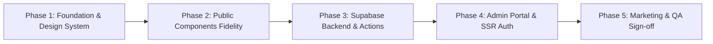

# Bhavatarini Catering Service — Architecture & Implementation Plan

**Document Status:** Approved & Refined Baseline  
**Date:** 1 November 2026  
**Target Stack:** Next.js (App Router), React, TypeScript (Strict Mode), Tailwind CSS, shadcn/ui, Supabase (PostgreSQL & SSR Auth), Resend, React Hook Form, Zod, Lucide React

---

## 1. System Architecture Overview

The Bhavatarini Catering Service platform is structured into two tightly integrated subsystems delivered as a complete, unified initial release:
1. **Public Web Application:** Editorial, high-performance, accessible single-page web presence mirroring `bhavatarini_catering_royal_green_premium_v2.html` with pixel-accurate fidelity, verified responsive behavior, and robust enquiry capture.
2. **Protected Admin Management Portal:** Role-restricted internal dashboard for catering operators to monitor incoming leads, update progress statuses, record operational notes, and manage customer requirements.

```mermaid
graph TD
    Client[Prospective Customer] -->|1. Browses Public Site| PublicWeb[Next.js App Router / SSR]
    Client -->|2. Submits Catering Enquiry| ServerAction[Next.js Server Action / Route Handler]
    
    subgraph Secure Server Environment
        ServerAction -->|Step A: Server Zod Validation & Anti-Spam Check| Validation[Input Validation & Sanitization]
        Validation -->|Step B: INSERT Record| SupabaseDB[(Supabase PostgreSQL: public.enquiries)]
        Validation -->|Step C: Isolated Try/Catch Notification| ResendAPI[Resend Transactional Email]
        ResendAPI -.->|Email Alert| OperatorEmail[Operator Inbox]
        ServerAction -->|Step D: Return Success + Optional WhatsApp URL| Client
    end

    Client -->|Step E: Confirmed On-Screen Toast / Modal| UIConfirmation[Submission Confirmation]
    UIConfirmation -.->|Optional Handoff IF Number Configured| WhatsApp[WhatsApp Web / Mobile App]

    subgraph Protected Admin Portal
        AdminUser[Catering Admin / Operator] -->|Login via Supabase SSR Auth| AdminUI[/admin Protected Dashboard]
        AdminUI -->|Middleware & Server-side Auth Guard| SessionVerify[Supabase SSR Session Validation]
        SessionVerify -->|Authorized Full CRUD via RLS| SupabaseDB
    end
```

---

## 2. Directory & Folder Architecture

```text
bhavatarini_catering/
├── docs/
│   ├── reference/
│   │   ├── PROJECT_HANDOVER.md
│   │   ├── bhavatarini_catering_homepage (2) (1).html
│   │   └── bhavatarini_catering_royal_green_premium_v2.html
│   ├── PROTOTYPE_ANALYSIS.md
│   └── IMPLEMENTATION_PLAN.md
├── public/
│   ├── images/
│   │   ├── menu/
│   │   │   ├── tiffin-tray-compartment.png   (Optimized WebP/PNG)
│   │   │   └── full-meals-traditional.webp
│   │   ├── hero/
│   │   │   └── hero-culinary-banner.webp
│   │   └── brand/
│   │       ├── logo.svg                       (Future approved vector logo)
│   │       └── favicon.ico
│   ├── robots.txt
│   └── sitemap.xml
├── src/
│   ├── app/
│   │   ├── (public)/
│   │   │   ├── layout.tsx                     (Public layout: Brand Topline, Header, Footer, Back-to-Top)
│   │   │   ├── page.tsx                       (One-page marketing landing page)
│   │   │   └── privacy-policy/page.tsx        (Mandatory privacy policy for collected lead data)
│   │   ├── (admin)/
│   │   │   ├── admin/
│   │   │   │   ├── layout.tsx                 (Protected layout with admin header & sidebar)
│   │   │   │   ├── page.tsx                   (Dashboard metrics, summary stats & recent leads)
│   │   │   │   └── enquiries/
│   │   │   │       ├── page.tsx               (Searchable, filterable enquiry list)
│   │   │   │       └── [id]/page.tsx          (Detailed enquiry view, status updater, internal notes)
│   │   │   └── login/
│   │   │       └── page.tsx                   (Admin authentication portal)
│   │   ├── api/
│   │   │   ├── enquiries/route.ts             (Enquiry submission route handler)
│   │   │   └── auth/callback/route.ts         (Supabase Auth callback handler)
│   │   ├── layout.tsx                         (Global root layout, fonts, metadata)
│   │   ├── globals.css                        (Tailwind CSS base & custom design tokens)
│   │   ├── sitemap.ts                         (Next.js dynamic sitemap generator)
│   │   └── robots.ts                          (Next.js robots directives)
│   ├── components/
│   │   ├── layout/
│   │   │   ├── brand-topline.tsx              (Sticky top tracking banner with live section spy)
│   │   │   ├── header.tsx                     (Header, desktop nav & mobile drawer)
│   │   │   ├── footer.tsx                     (Brand footer with copyright and dynamic year)
│   │   │   ├── scroll-progress.tsx            (Gold top scroll progress indicator)
│   │   │   └── back-to-top.tsx                (Floating scroll-to-top gold button)
│   │   ├── sections/
│   │   │   ├── hero-section.tsx               (Hero section with typography, parallax & CTAs)
│   │   │   ├── trust-strip.tsx                (4 credibility pillars with 48px icons)
│   │   │   ├── services-section.tsx           (Enriched 4 service cards with 62px badges & hover lift)
│   │   │   ├── experience-section.tsx         (The Bhavatarini Experience 4-card editorial narrative)
│   │   │   ├── menu-section.tsx               (Full Meals & Customised Tiffin showcase)
│   │   │   ├── why-us-section.tsx             (Why Choose Bhavatarini 4 value cards with 66px icons)
│   │   │   ├── cta-banner.tsx                 (Pre-contact action banner)
│   │   │   └── contact-section.tsx            (Contact info & React Hook Form enquiry form)
│   │   ├── ui/                                (shadcn/ui primitives: button, dialog, input, select, etc.)
│   │   └── admin/
│   │       ├── enquiry-table.tsx              (Data table with pagination and status filters)
│   │       ├── status-badge.tsx               (Color-coded status indicators)
│   │       └── notes-manager.tsx              (Internal operator notes thread)
│   ├── lib/
│   │   ├── config/
│   │   │   └── site.ts                        (Centralized environment variables and fallback helper)
│   │   ├── supabase/
│   │   │   ├── client.ts                      (Browser Supabase client for admin operations)
│   │   │   ├── server.ts                      (Server SSR Supabase client using cookies)
│   │   │   └── middleware.ts                  (Session refresh and route protection helper)
│   │   ├── resend.ts                          (Resend transactional email client)
│   │   ├── validations/
│   │   │   └── enquiry.ts                     (Zod schema for client and server validation)
│   │   ├── whatsapp.ts                        (WhatsApp message compiler and safe URL builder)
│   │   └── utils.ts                           (Tailwind cn utility and formatting helpers)
│   ├── types/
│   │   ├── database.types.ts                  (Generated Supabase TypeScript definitions)
│   │   └── enquiry.ts                         (Domain types for enquiry workflows)
│   └── middleware.ts                          (Global Next.js middleware for route guards)
├── .env.example
├── .gitignore
├── next.config.ts
├── tailwind.config.ts
├── tsconfig.json
└── package.json
```

---

## 3. Configuration & Business Information Management

### 3.1 Contact Information & Environment Variables
In strict accordance with business rules:
- **No fabricated or fake phone numbers, WhatsApp numbers, emails, addresses, or pricing will ever be displayed or used.**
- Contact parameters are externalized through environment variables.
- By default, variables for unconfirmed information are empty strings (`""`).
- The application code employs graceful fallbacks:
  - If `NEXT_PUBLIC_CONTACT_PHONE` is empty, the UI displays a clean invitation to enquire online rather than showing fake numbers or broken `tel:` links.
  - If `NEXT_PUBLIC_WHATSAPP_NUMBER` is empty, the WhatsApp handoff link is suppressed or gracefully omitted, and submissions complete with full on-screen confirmation without attempting to redirect to an unconfigured destination.
  - If `NEXT_PUBLIC_BUSINESS_ADDRESS` is empty, the UI displays the verified general location: `"Coimbatore, Tamil Nadu"` without inventing street names or door numbers.

#### Environment Variables Schema (`.env.example`):
```bash
# Public Contact Configuration (Keep empty until official details are provided)
NEXT_PUBLIC_WHATSAPP_NUMBER=""           # e.g., "919876543210" (digits only, with country code)
NEXT_PUBLIC_CONTACT_PHONE=""             # e.g., "+91 98765 43210" (formatted for display)
NEXT_PUBLIC_CONTACT_EMAIL=""             # e.g., "contact@bhavatarinicatering.com"
NEXT_PUBLIC_BUSINESS_LOCATION="Coimbatore, Tamil Nadu"
NEXT_PUBLIC_SERVICE_AREA="Coimbatore and nearby locations"
NEXT_PUBLIC_SITE_URL="http://localhost:3000"

# Supabase Configuration
NEXT_PUBLIC_SUPABASE_URL="https://your-project.supabase.co"
NEXT_PUBLIC_SUPABASE_ANON_KEY="your-anon-key"
SUPABASE_SERVICE_ROLE_KEY="your-service-role-key"   # Server-only! Never expose to client!

# Resend Email Configuration
RESEND_API_KEY="re_your_resend_api_key"             # Server-only!
OPERATOR_NOTIFICATION_EMAIL=""                      # Email address where catering leads are routed
```

### 3.2 Gallery Strategy (Option A Confirmed)
- The initial launch website will **remain 100% faithful to the approved `bhavatarini_catering_royal_green_premium_v2.html` prototype**.
- No artificial, stock, or generated gallery photographs will be added.
- The project architecture is structured so that a modular `GallerySection` can be seamlessly introduced in a future update as soon as authentic event and kitchen photographs are supplied by the business owner.

### 3.3 Preserved Business Positioning
- **Services:** Exactly four categories (Corporate Catering, Startup & Office Catering, Small Functions, Group Gatherings).
- **Menu Offerings:** Exactly two categories (Full Meals and Customised Tiffin).
- **Commercial Terms:** No invented prices, no per-plate claims, no fabricated minimum order quantities, and no fabricated delivery charges.

---

## 4. Database Schema & Supabase Architecture

### 4.1 PostgreSQL Schema (`public.enquiries`)

```sql
-- Create custom enum for enquiry lifecycle status
create type enquiry_status as enum (
  'new',
  'contacted',
  'quote_sent',
  'confirmed',
  'completed',
  'cancelled'
);

-- Main enquiries table
create table public.enquiries (
  id uuid primary key default gen_random_uuid(),
  created_at timestamp with time zone default timezone('utc'::text, now()) not null,
  updated_at timestamp with time zone default timezone('utc'::text, now()) not null,
  
  -- Customer Details
  name text not null,
  phone text not null,
  organisation text,
  
  -- Requirement Details
  requirement_type text not null,       -- 'Corporate office', 'Startup / team', 'Small function', 'Group gathering'
  food_preference text not null,        -- 'Full meals', 'Customised tiffin', 'Both meals and tiffin', 'Snacks'
  quantity_range text not null,         -- 'Below 50', '50–100', '100–200', '200–500', 'Above 500'
  details text,
  
  -- Internal Management & Tracking
  status enquiry_status default 'new'::enquiry_status not null,
  internal_notes text,
  whatsapp_initiated boolean default false,
  email_notification_sent boolean default false,
  ip_hash text,
  user_agent text
);

-- Performance indices
create index enquiries_created_at_idx on public.enquiries (created_at desc);
create index enquiries_status_idx on public.enquiries (status);
create index enquiries_phone_idx on public.enquiries (phone);

-- Admin profile reference table for authorization
create table public.admin_profiles (
  id uuid primary key references auth.users(id) on delete cascade,
  email text not null unique,
  full_name text not null,
  role text default 'admin' not null,
  created_at timestamp with time zone default timezone('utc'::text, now()) not null
);
```

### 4.2 Row Level Security (RLS) Policies
Security is enforced at the database layer via PostgreSQL RLS:

1. **Enable RLS on all tables:**
   ```sql
   alter table public.enquiries enable row level security;
   alter table public.admin_profiles enable row level security;
   ```
2. **Public / Anonymous Policy (`anon`):**
   - **`INSERT`:** Permitted for anonymous users submitting the public form.
   - **`SELECT`, `UPDATE`, `DELETE`:** Strictly forbidden (`false`). Anonymous visitors can never query or inspect stored enquiries.
   ```sql
   create policy "Allow anonymous insertion of enquiries"
     on public.enquiries
     for insert
     to anon
     with check (true);
   ```
3. **Admin User Policy (`authenticated`):**
   - Authenticated users whose `auth.uid()` exists in `public.admin_profiles` have full `SELECT`, `UPDATE`, and `DELETE` permissions.
   ```sql
   create policy "Allow admins full access to enquiries"
     on public.enquiries
     for all
     to authenticated
     using (
       exists (
         select 1 from public.admin_profiles
         where admin_profiles.id = auth.uid()
       )
     );
   ```

---

## 5. Resilient Enquiry Workflow

```mermaid
sequenceDiagram
    autonumber
    actor Customer as Prospective Customer
    participant Form as Contact Form (Client)
    participant Action as Next.js Server Action
    participant DB as Supabase PostgreSQL
    participant Email as Resend API
    actor Operator as Catering Operator

    Customer->>Form: Fills form & clicks Submit
    Form->>Form: Client Zod Validation (Phone format, required fields, honeypot)
    Form->>Action: POST payload to Server Action
    Action->>Action: Server Zod Validation & Anti-Spam Check
    
    rect rgb(240, 248, 255)
        Note over Action,DB: Phase 1: Reliable Database Storage (Must Succeed)
        Action->>DB: INSERT into public.enquiries (status: 'new')
        DB-->>Action: Confirmation with Record ID
    end

    rect rgb(255, 250, 240)
        Note over Action,Email: Phase 2: Decoupled Email Notification (Non-blocking)
        alt Resend Configured & Operator Email Present
            Action->>Email: Send formatted lead notification
            alt Delivery Succeeded
                Email-->>Operator: Delivers new enquiry email
                Action->>DB: UPDATE email_notification_sent = true
            else Delivery Failed / Network Issue
                Action->>Action: Catch error, log warning; DO NOT abort enquiry
            end
        end
    end

    rect rgb(240, 255, 240)
        Note over Action,Form: Phase 3: Client Resolution & Optional WhatsApp Handoff
        Action-->>Form: Return success status + enquiry ID + optional WhatsApp URL
        Form->>Customer: Display on-screen success toast & enquiry reference
        opt WhatsApp Number is Configured
            Form->>Customer: Offer / Trigger optional WhatsApp chat with pre-filled message
        end
    end
```

### Key Workflow Guarantees:
1. **Server-Side Validation:** All submissions undergo strict validation using Zod on the server.
2. **Prioritized Persistence:** The enquiry is saved in Supabase before any downstream notification is attempted.
3. **Resend Fault Tolerance:** The Resend email invocation is wrapped in an isolated `try/catch` block. If email delivery encounters an error or timeout, the enquiry record remains safely saved in the database.
4. **Independent WhatsApp Channel:** Opening WhatsApp is never a requirement for successful enquiry submission. If the customer does not have WhatsApp, is on desktop, or cancels out, the lead is already captured in Supabase.

---

## 6. Admin Dashboard Architecture & Implementation Plan

The Admin Dashboard is a core component of the initial website release and must be fully built, verified, and tested prior to deployment.

### 6.1 Authentication & Security Model
- **Supabase SSR:** Implemented with `@supabase/ssr` utilizing secure HTTP-only cookies to eliminate token theft risks.
- **Middleware Guard (`src/middleware.ts`):** 
  - Intercepts all `/admin/*` routes.
  - Verifies the user session via Supabase SSR.
  - Redirects unauthenticated requests to `/login?returnUrl=/admin`.
  - Re-checks admin authorization on the server inside Server Components to guarantee defense in depth.
- **Restricted Registration:** Public user sign-up is disabled. Admin accounts are provisioned exclusively through Supabase Dashboard or protected seed commands.
- **Strict Key Isolation:** `SUPABASE_SERVICE_ROLE_KEY` and `RESEND_API_KEY` are never imported into any client component or exposed in the browser bundle.

### 6.2 Admin Features & User Interface
1. **Overview Dashboard (`/admin`):**
   - KPI Stat Cards: Total Enquiries, New Enquiries (Past 7 Days), Quotes Pending, Confirmed Events.
   - Lead Velocity Chart: Inbound enquiries grouped by week.
   - Recent Enquiries Table: 5 most recent submissions with quick action buttons.
2. **Enquiry Listing & Filtering (`/admin/enquiries`):**
   - Search: Filter by customer name, mobile number, or company name.
   - Status Filters: `All`, `New`, `Contacted`, `Quote Sent`, `Confirmed`, `Completed`, `Cancelled`.
   - Category Filters: Filter by requirement type (`Corporate`, `Startup`, `Small Function`, `Group Gathering`).
   - Sorting: Ascending/descending by submission date.
   - Pagination: Clean 10/25 items per page with responsive tabular presentation.
3. **Enquiry Details & Operator Tools (`/admin/enquiries/[id]`):**
   - Customer profile: Name, phone, organisation.
   - Requirement summary: Type, food preference, guest count range, event details.
   - Quick Action: Click-to-call link and one-click direct WhatsApp chat launcher.
   - Status Transition Selector: Dropdown updating the database record immediately with toast confirmation.
   - Internal Notes: Operator comments area to track quotes given, customer requests, and follow-up schedules.

---

## 7. SEO & Digital Marketing Readiness

1. **Next.js Metadata API:**
   - Single canonical `h1` in the hero section.
   - Precise page title: `Bhavatarini Catering Service | Traditional South Indian Catering, Coimbatore`.
   - Descriptive meta tags, Open Graph image, and Twitter Cards configured in `src/app/layout.tsx`.
2. **Local SEO for Coimbatore:**
   - JSON-LD Structured Data embedding `CateringService` and `FoodEstablishment`:
     ```json
     {
       "@context": "https://schema.org",
       "@type": "CateringService",
       "name": "Bhavatarini Catering Service",
       "description": "Homely, hygienic and reliable traditional South Indian catering for corporate offices, startups, small functions and gatherings in Coimbatore.",
       "address": {
         "@type": "PostalAddress",
         "addressLocality": "Coimbatore",
         "addressRegion": "Tamil Nadu",
         "addressCountry": "IN"
       },
       "servesCuisine": "South Indian Traditional"
     }
     ```
3. **Search Engine Indexing:**
   - Dynamic `src/app/sitemap.ts` providing automatic sitemap generation.
   - Dynamic `src/app/robots.ts` ensuring public pages are indexable while disallowing `/admin` and `/api` paths.
4. **Analytics & Privacy Readiness:**
   - Centralized analytics event dispatcher ready for GA4 / GTM integration.
   - Custom conversion events: `enquiry_submitted`, `whatsapp_clicked`, `phone_clicked`.
   - Personal information (customer name, phone, notes) is strictly excluded from analytics payloads.

---

## 8. Phased Implementation Roadmap

All five phases comprise the complete initial release:



### Phase 1: Foundation & Design System Setup
- Initialize Next.js App Router with TypeScript (strict) and Tailwind CSS.
- Configure Tailwind tokens mirroring Layer 4 CSS (`--green: #123c2c`, `--gold: #c7a45b`, etc.).
- Load Google Fonts (`Playfair Display` + `DM Sans`) via `next/font`.
- Set up Lucide React, utility functions (`cn`), and centralized configuration (`site.ts`).

### Phase 2: Public Website Component Fidelity
- Build `BrandTopline` with live section spy.
- Build `Header` with responsive navigation drawer.
- Build `HeroSection` with typography, CTAs, and scroll parallax.
- Build `TrustStrip` and enriched `ServicesSection` matching 62px icon badges and hover effects.
- Build `ExperienceSection` mid-page editorial story cards.
- Build `MenuSection` with Full Meals and Customised Tiffin cards.
- Build `WhyUsSection` with 66px icon discs and hover lines.
- Build `CTABanner`, `Footer`, `ScrollProgress`, and `BackToTop` button.

### Phase 3: Supabase Backend & Dual-Channel Form
- Configure Supabase client, migration script for `enquiries` table, and RLS policies.
- Build `ContactSection` with React Hook Form and Zod validation.
- Implement server action / route handler with database insertion.
- Add Resend email notification in an isolated, non-blocking try/catch.
- Add optional WhatsApp handoff logic respecting configuration variables.

### Phase 4: Admin Portal & SSR Auth
- Implement Supabase SSR auth helpers and middleware route guard for `/admin/*`.
- Build `/login` portal with clean, branded design.
- Build `/admin` dashboard overview with metrics and recent enquiries.
- Build `/admin/enquiries` data table with status filtering, search, and pagination.
- Build `/admin/enquiries/[id]` detail view with status updater and internal notes manager.

### Phase 5: SEO, Marketing & Production Polish
- Implement Open Graph metadata, JSON-LD schema, sitemap, and robots.
- Conduct cross-browser, responsive, and accessibility audits.
- End-to-end verification of the enquiry lifecycle from public form to admin status update.
- Final sign-off before production readiness.
