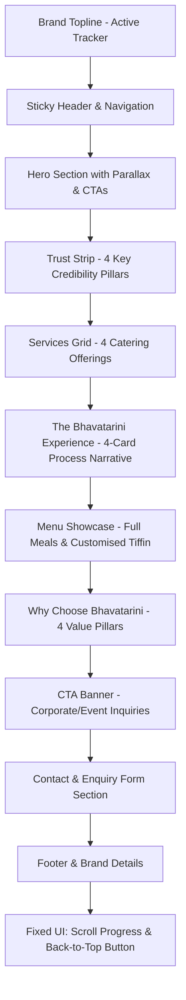

# Bhavatarini Catering Service — Comprehensive Prototype Analysis

**Document Status:** Complete & Verified  
**Date:** 1 November 2026  
**Primary Reference Files Inspected:**
- `docs/reference/bhavatarini_catering_royal_green_premium_v2.html` (Primary visual and behavioural source of truth — 4,080,558 bytes)
- `docs/reference/bhavatarini_catering_homepage (2) (1).html` (Baseline prototype — 384,900 bytes)
- `docs/reference/PROJECT_HANDOVER.md` (Project requirements, business parameters & scope — 64,508 bytes)
- `AGENTS.md` (Developer guidance, architecture, constraints & coding rules)
- `README.md` (Project overview and setup notes)
- `public/images/a_high_quality_well_lit_food_product_photography.png` (Standalone high-res menu asset — 1448x1086, 2.75 MB)

---

## 1. Executive Summary & Prototype Overview

Bhavatarini Catering Service is a traditional South Indian catering business based in Coimbatore, Tamil Nadu, India. The primary objective of the web application is to present traditional catering services with an editorial, high-end visual elegance and convert corporate teams, startups, family function planners, and event organizers into high-intent catering enquiries.

The latest prototype, `bhavatarini_catering_royal_green_premium_v2.html`, serves as the **unconditional primary visual and behavioural baseline**. It evolved across four cumulative iterative CSS/HTML layers, culminating in an editorial, spacious aesthetic inspired by the refined visual rhythm of institutional editorial sites (e.g., SIET) adapted specifically for a heritage South Indian culinary brand.

### Prototype Evolution & Layer Architecture
An in-depth inspection of the HTML and stylesheet reveals that `bhavatarini_catering_royal_green_premium_v2.html` contains four cascaded `:root` and style blocks:
1. **Layer 1 (Original Base Prototype):** Basic grid, green/cream palette (`--green: #123b1d; --gold: #f4d879`), serif headings with basic card tiles.
2. **Layer 2 (Premium Editorial Redesign):** Introduction of the mid-page narrative experience section (`.experience-section`), scroll reveals via `IntersectionObserver`, scroll progress bar, and refined typography.
3. **Layer 3 (Royal Green Baseline):** Deepened forest green hues (`--green: #123b2a; --gold: #c9a85c`), addition of the sticky top live active-section indicator (`.brand-topline`), and embedded base64 food photography.
4. **Layer 4 (Final Polish v2 - Active Baseline):**
   - **Enriched Service Cards:** Increased card sizing, dimensional hover elevation (`translateY(-10px)`), gold top accent line animation (`scaleX(1)`), concentric circular watermark pseudo-elements (`::after`), and enlarged 62px icon badges.
   - **Enlarged Trust Strip & "Why Choose Us":** Scaled up circular icon containers (66px for Why Us, 48px for Trust Strip) with 34px symbols and enhanced typography for high legibility.
   - **Refined Color Tokens:** The final CSS variable set in `:root` represents the authoritative design system.

---

## 2. Design System & Visual Specifications

### 2.1 Authoritative Color Palette (Layer 4 Tokens)
The final `:root` declarations establish the approved color palette:

| Token Name | Hex Code | Role in Interface | Visual Treatment & Context |
| :--- | :--- | :--- | :--- |
| `--green` | `#123C2C` | Primary Royal Forest Green | Deep green brand base, hero background, headers, section accents |
| `--green2` | `#1C573E` | Secondary Forest Green | Gradient stops, subtle background depth, hover states |
| `--leaf` | `#718B62` | Muted Leaf Green | Soft organic accents, badges, tertiary accents |
| `--cream` | `#FAF8F1` | Primary Warm Ivory | Main page background (`body`), light cards, clean breathing room |
| `--cream2` | `#EEE7D7` | Secondary Warm Ivory | Section gradient transitions, input backgrounds, subtle card fills |
| `--gold` | `#C7A45B` | Antique Gold Accent | Primary CTA button gradient, active nav indicator, divider lines |
| `--ink` | `#17271E` | Deep Dark Greenish Ink | Primary typography, high-contrast headings, body text |
| `--muted` | `#6F786F` | Muted Neutral Gray-Green | Supporting descriptions, secondary labels, helper text |
| `--line` | `#E5DECE` | Divider / Border Neutral | Card borders, subtle separating strokes, table dividers |

#### Special Gradient & Surface Recipes Verified in Prototype:
- **Hero Radial Gradient:** `radial-gradient(ellipse at 15% 20%, #315d43 0%, #17432f 45%, #0b291d 100%)`
- **Hero Dot Pattern Overlay:** `radial-gradient(rgba(255,255,255,.35) .65px, transparent .65px)` with `background-size: 7px 7px; opacity: 0.12; mask-image: linear-gradient(90deg, #000, transparent 75%)`
- **Editorial Experience Section:** `radial-gradient(ellipse at 85% 10%, #28553d 0%, #163e2b 42%, #0c2b1e 100%)` with gold inner stroke `inset: 18px; border: 1px solid rgba(210,184,117,0.14)`
- **CTA Banner Radial:** `radial-gradient(ellipse at 90% 0%, #2c6244, #17432f 48%, #0e3021)` with gold border `1px solid rgba(199,164,91,0.5)`
- **Footer Gradient:** `linear-gradient(120deg, #09271a, #123c2a)`
- **Gold Button Gradient:** `linear-gradient(135deg, #d4ba78, #b89347)` with gold border and dark ink text
- **Dark Green Button Gradient:** `linear-gradient(135deg, #174a34, #0d3021)` with hover `linear-gradient(135deg, #286246, #17432f)`
- **Top Sticky Bar:** Background `#0b2b1d`, text `#d8c38a`, bottom border `1px solid rgba(205,174,101,0.25)`

### 2.2 Typography Hierarchy
The typography leverages two Google Fonts paired for editorial elegance:
1. **Headings & Display Typography:** `Playfair Display`, serif (Weights: 500, 600, 700, 800; Fallback: `Georgia, serif`).
2. **Body, Interface & Form Typography:** `DM Sans`, sans-serif (Weights: 400, 500, 600, 700; Fallback: `Arial, sans-serif`).

#### Typographic Scales & Styles:
- **Hero Heading (`h1`):** `font-family: 'Playfair Display'; font-size: clamp(48px, 5.2vw, 76px); line-height: 1.01; letter-spacing: -2.1px; font-weight: 600;`
  - Italic accent (`em`): `font-weight: 500; color: #e2cb8e; font-style: italic;`
- **Section Headings (`h2`):** `font-family: 'Playfair Display'; font-size: clamp(34px, 4vw, 48px); line-height: 1.1; letter-spacing: -0.8px; color: var(--green);`
- **Section Kickers (`.section-kicker`):** `font-family: 'DM Sans'; font-size: 9px; letter-spacing: 2.6px; font-weight: 700; text-transform: uppercase; color: #a18448;`
- **Section Heading Divider:** `::after` pseudo-element: `width: 42px; height: 1px; background: #c7a45b; margin: 23px auto 0;`
- **Service Card Titles (`h3`):** `font-family: 'Playfair Display'; font-size: 23px; line-height: 1.2; letter-spacing: -0.35px; color: #153e2c;`
- **Body Text (`p`):** `font-family: 'DM Sans'; font-size: 15px; line-height: 1.8; color: var(--muted);`
- **Topline Tracker Text:** `font-size: 8px; letter-spacing: 1.8px; font-weight: 600; text-transform: uppercase;`

### 2.3 Layout, Spacing & Container Metrics
- **Main Container:** Max width `1240px`, horizontal padding `5%` (on desktop `calc((100% - 1240px)/2)`).
- **Section Spacing:** Desktop padding `96px 0`, mobile padding `55px 0`.
- **Border Radii:**
  - Micro-radii on primary cards (`2px` to `7px` for editorial precision).
  - Perfect circles (`50%`) for icon badges, back-to-top button, and section indicator dots.
  - Generous pill shapes (`999px`) for menu badges and tags.
- **Card Elevations & Shadows:**
  - Standard card: `box-shadow: 0 10px 28px rgba(24, 52, 35, 0.045);`
  - Hover elevation: `box-shadow: 0 24px 48px rgba(24, 52, 35, 0.12); transform: translateY(-10px);`
  - Floating controls (Back to Top): `box-shadow: 0 8px 25px rgba(0, 0, 0, 0.16);`

---

## 3. Detailed Page Sections & Component Breakdown



### 3.1 Scroll Progress Bar (`#scrollProgress`)
- **Structure:** Positioned fixed at `top: 0, left: 0`, height `3px`, `z-index: 100`.
- **Visuals:** Gold gradient `linear-gradient(90deg, #c49b3b, #f1d98b)`, subtle glow box-shadow `0 0 9px rgba(216, 182, 92, 0.55)`.
- **Behaviour:** Width animates from `0%` to `100%` based on document scroll percentage via requestAnimationFrame.

### 3.2 Sticky Brand Topline (`.brand-topline`)
- **Structure:** `position: sticky; top: 0; z-index: 31; height: 31px;`
- **Content:**
  - Left: `COIMBATORE · TAMIL NADU` (uppercase, tracking 1.8px, antique gold tone).
  - Right (`.topline-current`): Glowing gold pulsing dot (`width: 6px; height: 6px; border-radius: 50%`), followed by dynamic section label (`#activeSectionLabel`), and section number (`#activeSectionNumber` e.g., `01`, `02`, `03` separated by vertical divider).

### 3.3 Main Header & Navigation (`<header>`, `.nav`)
- **Structure:** `position: sticky; top: 31px; z-index: 30;` backdrop blur with semi-transparent warm ivory / green border.
- **Brand Wordmark:**
  - Circular badge (`.brandmark`): `♨` steam symbol on warm gold/cream gradient with double border and inner shadow.
  - Wordmark text: "Bhavatarini" in Playfair Display serif with small kicker `Catering Service` underneath.
- **Desktop Nav Links (`#nav`):** `Home (#home)`, `Services (#services)`, `Menu (#menu)`, `Why Us (#why)`, `Contact (#contact)`.
  - Active State: Antique gold text, animated bottom underline bar, and top mini gold dot (`::before`).
- **Header CTAs:**
  - Desktop: "Enquire Now ↗" button (`href="#contact"`).
  - Mobile Menu Toggle (`#toggle`): Hamburger button (`☰`) with ARIA label.

### 3.4 Hero Section (`#home`)
- **Layout:** Asymmetric two-column split (`minmax(0, 0.88fr)` to `minmax(0, 1.12fr)`), min-height `620px`.
- **Left Column (Copy):**
  - Eyebrow: `Traditional South Indian Catering`
  - Headline: `Good Food.` `<br>` `<em>Beautifully</em> Served.` `<br>` `Every Occasion.`
  - Lead Paragraph: `Homely, hygienic and reliable catering for corporate offices, startups, small functions and gatherings.`
  - CTA Group:
    - Primary CTA: `Request a Quote →` (`.btn.gold`, anchor to `#contact`)
    - Secondary CTA: `☏ Chat on WhatsApp` (`.btn.outline`, anchor to `#contact`)
- **Right Column (Hero Photo):**
  - High-impact culinary visual with left-to-right fade mask blending seamlessly into deep forest green background.
  - Subtle scroll parallax bound to scroll offset on screens `> 850px`.

### 3.5 Trust Strip (`.trust`)
- **Layout:** 4-column responsive grid directly beneath hero (`min-height: 82px`).
- **Items:**
  1. `❧` **Traditional Taste:** "Authentic South Indian food"
  2. `♧` **Hygienic & Safe:** "Care in every preparation"
  3. `♧` **Flexible for Your Needs:** "Meals, tiffin and custom orders"
  4. `▣` **Reliable Service:** "Planned and organised catering"
- **Styling:** 48px circular icon discs with antique gold border, 34px glyphs, vertical dividing borders between items.

### 3.6 Services Section (`#services`)
- **Header:** Kicker `01 / WHAT WE DO`, Title `Our Catering Services`, Subtitle `Catering solutions tailored for offices, teams and special occasions.`
- **Grid:** 4 cards in a 4-column desktop layout (`repeat(4, minmax(0, 1fr))`).
- **Card Breakdown:**
  1. `▦` **Corporate Catering:** "Daily meals, office lunches, meetings and corporate events."
  2. `🚀` **Startup & Office Catering:** "Breakfast, lunch and food arrangements for growing teams."
  3. `✧` **Small Functions:** "Housewarming, birthdays and private celebrations."
  4. `♧` **Group Gatherings:** "Food arrangements for social and community events."
- **Layer 4 Enriched Styling:**
  - Card min-height `320px`, padding `34px 24px 30px`.
  - Icon container: 62px diameter circle with gold border, inset white glow, 29px symbol. Hover rotates -5deg and shifts up.
  - Decorative watermark: Concentric circular gold rings pseudo-element (`::after`, 150px) at bottom right of card, scaling up on hover.
  - Top gold bar: 3px animated indicator (`scaleX(0.18)` expanding to `scaleX(1)` on hover).

### 3.7 "The Bhavatarini Experience" / Our Approach (`#our-approach`)
- **Design Philosophy:** Editorial mid-page story section inspired by high-end institutional storytelling.
- **Container Styling:** Deep forest green radial gradient, double gold inset perimeter border (`18px` inset).
- **Header:** Kicker `02 — THE BHAVATARINI EXPERIENCE`, Headline `Good food. Thoughtfully served.` with subtitle.
- **4-Card Asymmetrical Grid:**
  1. **Card 01 (`.exp-large`):** Warm parchment beige gradient, large `01` numeral, `✦` icon, title "Tell us what you're planning.", subtitle, and footer link "START WITH AN ENQUIRY ↗".
  2. **Card 02 (`.exp-image`):** Photo card with dark gradient overlay, subtitle `MADE TO SUIT YOUR DAY`, heading `A menu that fits your people.`
  3. **Card 03 (`.exp-light`):** Soft ivory card, numeral `02`, `❋` icon, title "Choose your menu.", subtitle describing signature full meals or curated tiffin.
  4. **Card 04 (`.exp-gold`):** Warm gold card, numeral `03`, `♧` icon, title "We prepare. You enjoy.", subtitle on coordinating office/gathering food arrangements.
- **Section Foot:** Two-sided branded banner: `PEOPLE / FOOD / OCCASIONS` on left, `BHAVATARINI CATERING SERVICE` on right.

### 3.8 Menu Section (`#menu`)
- **Header:** Kicker `03 / FROM OUR KITCHEN`, Title `Our Menu`, Subtitle `Wholesome traditional meals and customised tiffin options to suit your requirements.`
- **Grid:** 2 large horizontal split cards:
  1. **Card 1 — Full Meals:**
     - Left: South Indian traditional meals photograph.
     - Right: Title `❧ Full Meals`, pill badge `Our Signature Menu`, itemized list: `Rice · Sambar · Rasam · Kuzhambu · Poriyal · Appalam · Curd · Payasam · Pickle`.
  2. **Card 2 — Tiffin (Customised):**
     - Left: Dedicated stainless-steel compartment tiffin photo with dark green backdrop and badge `CUSTOMISED TIFFIN`.
     - Right: Title `♨ Tiffin (Customised)`, description "Tiffin combinations curated based on your team's needs and preferences.", tag cloud: `Idli`, `Dosa`, `Pongal`, `Upma`, `Vada`, `Bajji`, `Samosa`, `& more`.

### 3.9 Why Choose Bhavatarini (`#why`)
- **Header:** Kicker `04 / THE BHAVATARINI PROMISE`, Title `Why Choose Bhavatarini?`, Subtitle `Good food, thoughtful preparation and dependable service.`
- **Grid:** 4 clean cards in a 4-column grid.
- **Items:**
  1. `✿` **Consistent Quality**
  2. `▣` **Flexible & Customisable**
  3. `♧` **Carefully Prepared**
  4. `♡` **Service You Can Rely On**
- **Styling:** 66px icon discs, 34px symbols, centered titles, bottom animated gold line expanding on hover.

### 3.10 Intermediate CTA Banner (`.cta`)
- **Location:** Placed directly between `#why` and `#contact`.
- **Visuals:** Dark forest green radial background with gold border.
- **Content:** Title `Planning a Corporate Meal or an Event?`, Subtitle `Tell us what you need. We’ll help you plan the right menu.`, Action buttons: `Request a Catering Quote →` and `☏ Send an Enquiry`.

### 3.11 Contact & Enquiry Section (`#contact`)
- **Header:** Kicker `05 / LET'S TALK`, Title `Let's Plan Your Catering`, Subtitle `Share a few details and we'll get back to you.`
- **Two-Column Split Layout:**
  - **Left Column (`.contact-info`):**
    - Headline: `Made for teams, gatherings and good food.`
    - Copy: `Whether you need regular office meals or catering for a one-time event, send us your requirements.`
    - Meta 1: `Service area: Coimbatore and nearby locations`
    - Meta 2: `Phone / WhatsApp: Add your business number before publishing` (Explicit placeholder)
  - **Right Column (`.form`):**
    - Ivory card with 3px solid antique gold top accent border.
    - Fields:
      1. `name`: Your name (Required text)
      2. `phone`: Mobile number (Required tel, placeholder "10-digit mobile number")
      3. `org`: Company / Organisation (Optional text)
      4. `kind`: Requirement type (Dropdown: Corporate office, Startup / team, Small function, Group gathering)
      5. `food`: Food preference (Dropdown: Full meals, Customised tiffin, Both meals and tiffin, Snacks)
      6. `qty`: Approx. quantity (Dropdown: Below 50, 50–100, 100–200, 200–500, Above 500)
      7. `details`: Date, location and other details (Textarea, full width)
      8. Submit Button: `Send Enquiry via WhatsApp ↗`

### 3.12 Footer & Ancillary Components
- **Footer:** Deep night-green gradient (`#09271a` to `#123c2a`), Playfair Display brand title, tagline `Traditional Taste. Quality Service. Every Occasion.`, dynamic year via JS (`#year`).
- **Back to Top Button (`#backTop`):** Circular floating gold button at bottom right, visible after 480px scroll, smooth scrolls to top.
- **Toast Notification (`#toast`):** Hidden notification container in DOM for asynchronous feedback.

---

## 4. Existing Interactions, JavaScript & Animation System

### 4.1 Scroll Reveal System
- Targets: `section .section-head, .service, .menu-card, .why-item, .cta, .contact-info, .form, .trust-item`.
- Varied Entry Directions: Elements are assigned classes dynamically via modulo arithmetic:
  - `i % 5 === 1`: `.reveal-left` (slides in from left `translateX(-34px)`)
  - `i % 5 === 3`: `.reveal-right` (slides in from right `translateX(34px)`)
  - Others: `.reveal` (slides up from bottom `translateY(28px)`)
- Stagger Delays: Service cards and Why items receive inline `transitionDelay = (i % 4) * 85 + 'ms'`.
- IntersectionObserver triggers `.is-visible` at threshold `0.12` and rootMargin `0px 0px -35px 0px`.
- Fallback: Under `prefers-reduced-motion: reduce` or unsupported browsers, `.is-visible` is added immediately.

### 4.2 Active Section Spy
- Monitored Sections: `['home', '01']`, `['services', '02']`, `['our-approach', '03']`, `['menu', '04']`, `['why', '05']`, `['contact', '06']`.
- Second IntersectionObserver with rootMargin `-24% 0px -58% 0px` and thresholds `[0, 0.1, 0.25, 0.5, 0.75]` computes highest intersection ratio.
- Dynamically updates `#activeSectionLabel`, `#activeSectionNumber`, and syncs header links with `.active` and `aria-current="location"`.

### 4.3 Client-Side WhatsApp Assembly
- Form submit listener intercepts event (`e.preventDefault()`).
- Concatenates field values into formatted text string:
  ```text
  Hello Bhavatarini Catering Service! I would like to enquire about catering.
  Name: {name}
  Mobile: {phone}
  Organisation: {org || 'Not specified'}
  Requirement: {kind}
  Food preference: {food}
  Quantity: {qty}
  Details: {details || 'Not specified'}
  ```
- Launches `window.open('https://wa.me/?text=' + encodeURIComponent(msg), '_blank', 'noopener')`.
- **Known Limitation:** The URL lacks a destination phone number.

### 4.4 Responsive Navigation Toggle
- Mobile toggle `#toggle` adds/removes `.open` on `#nav`.
- Clicking any link within `#nav` removes `.open` to dismiss mobile overlay.

### 4.5 Hero Image Parallax
- Active on viewports `min-width: 851px` without reduced motion.
- Translates `.hero-photo` `background-position: center ${50 + y * 0.035}%` clamped to `500px` scroll.

---

## 5. Responsive Behaviour & Breakpoint Matrix

The CSS contains 21 `@media` blocks across iterations. A synthesis of the active cascade yields the following key responsive behaviors:

| Breakpoint Range | Target Devices | Visual & Layout Adjustments in Prototype |
| :--- | :--- | :--- |
| **> 1000px** | Desktop & Large Displays | 4-column Services & Why Us grids; 4-column Trust Strip; Asymmetric 2-column Hero; 4-card 4-column Experience grid; 2-column Menu cards. |
| **851px – 1000px** | Laptop & Landscape Tablets | Services and Why Us drop to 2x2 grids (`grid-template-columns: repeat(2, minmax(0, 1fr))`); Trust strip drops to 2x2 grid; 2nd item right border removed; Hero parallax active. |
| **621px – 850px** | Portrait Tablets & Phablets | Header navigation collapses into mobile hamburger menu; Hero stacks into single column (photo min-height 420px below copy); Experience grid switches to 2x2; Menu cards stack vertically. |
| **391px – 620px** | Large Mobile (iPhone/Pixel) | Services and Why Us remain 2 columns with reduced padding and compact icons (51px for service, 55px for why); Trust strip stacks 2 columns with 40px icons; Experience cards drop to min-height 245px; Form inputs stack into single column. |
| **≤ 390px / 380px** | Small Mobile (SE, older phones) | Service cards padding reduced to `20px 13px`, titles `16px`, body `10px`; Hero heading scales to `41px` with `clamp(43px, 11vw, 58px)`; Brand topline compacts to `28px` height. |

---

## 6. Images & Assets Inventory

| Asset Name / Source | Type & Format | Dimensions / Size | Purpose in Prototype | Production Recommendation |
| :--- | :--- | :--- | :--- | :--- |
| `public/images/a_high_quality_well_lit_food_product_photography.png` | Standalone PNG | 1448 × 1086 px (2.75 MB) | Customized Tiffin container menu card image | High-res source. Convert to WebP / AVIF via Next.js `Image` for web optimization (<150 KB). |
| Embedded Base64 JPEG #1 | Embedded JPEG (in HTML) | 594 × 403 px (65.9 KB) | Hero background image | Replace with genuine approved food photo or extract to optimized WebP. |
| Embedded Base64 JPEG #2 | Embedded JPEG (in HTML) | 594 × 403 px (65.9 KB) | Full Meals menu card photo | Identical to Hero image; requires distinctive full meals photography. |
| Embedded Base64 JPEG #3 | Embedded JPEG (in HTML) | 594 × 403 px (65.9 KB) | Experience section Card 02 (`.exp-image`) | Identical to Hero image; requires distinctive catering setup photo. |
| Embedded Base64 PNG | Embedded PNG (in HTML) | 1448 × 1086 px (3.66 MB base64) | Tiffin menu card photo | Identical to standalone PNG file. Remove base64 duplication from bundle. |
| Brandmark Glyph (`♨`) | Unicode character | Vector text glyph | Visual logo mark in header wordmark | Replace with SVG or official brand vector when supplied by owner. |
| Category Glyphs (`▦`, `🚀`, `✧`, `♧`, `✿`, `▣`, `♡`) | Unicode symbols | Vector text glyphs | Service and value pillar icons | Map to polished Lucide React icons matching these visual concepts. |

---

## 7. Missing Features, Functional Gaps & Technical Limitations

1. **No Database Persistence:** Enquiries are passed directly to WhatsApp via URL; if the user's browser fails to open WhatsApp, or if the user cancels out, the lead is permanently lost.
2. **Missing WhatsApp Recipient Number:** Current script has `https://wa.me/?text=...` with no target phone number.
3. **No Admin Dashboard or Authentication:** The prototype lacks any back-office interface for tracking leads, updating status, recording notes, or reviewing quotes.
4. **No Email Delivery:** Resend integration is requested in handover specifications but completely unbuilt.
5. **No Separate Gallery Section:** Explicitly requested in the project handover, but missing from the prototype.
6. **No Production Form Validation:** No custom phone number validation (Indian 10-digit regex), email validation, or server-side input sanitization.
7. **CSS Redundancy & Cascade Clutter:** Four overlapping layers of CSS with conflicting `:root` values and duplicate selectors. Refactoring into Tailwind CSS utility classes and design tokens will dramatically improve maintainability.
8. **Missing Verified Business Details:**
   - Official contact phone number
   - Verified WhatsApp number with country code (+91)
   - Official email address
   - Physical address / catering kitchen location
   - Exact delivery radius and serviceable localities in Coimbatore
   - Menu pricing, minimum order quantities, and advance booking terms.
9. **SEO & Marketing Integrations Absent:** Lacks Open Graph metadata, JSON-LD LocalBusiness schema, Sitemap, Robots.txt, and GA4/GTM conversion triggers.
