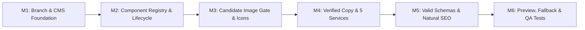

# Bhavatarini Catering Service — Refinement Action Plan & Implementation Blueprint

**Document Reference:** `docs/REFINEMENT_ACTION_PLAN.md`  
**Revision:** 2.1 (Final Architecture Review Corrections)  
**Date:** November 2026  
**Status:** Integrated Architecture & Refinement Action Plan (Stage A Deliverable — Documentation Only)  
**Target Branch:** `refactor/cms-content-assets-seo`  
**Base Commit:** `main` (commit `06910d0`)

---

## 1. Overview & Strategy

This action plan defines the sequential execution roadmap for **Stage B** across:
1. **Sanity CMS & Central Component Registry** (per `docs/SANITY_CMS_ARCHITECTURE.md`).
2. **Verified Business Copy & Five Confirmed Services** (Corporate Catering, Small Family Functions, Group Gatherings, Daily Meal Supply, Startup & Office Catering).
3. **Draft Status for Menu Items:** Prototype dishes are classified strictly as unverified draft examples; menus in Sanity will hold a `draft_unverified` status until confirmed by the owner.
4. **Neutral Service Phrasing:** Removal of unsupported quality claims or operational promises (such as "reliable", guaranteed delivery, specific meal schedules, or unverified customization commitments).
5. **Strict Image Replacement Gate:** Generic stock platform links are prohibited as approval criteria. Replacements require exact candidate image-page URLs, previews, individual commercial license verification, and verified dimensions. Image replacement remains **completely blocked** until owner sign-off. Official logo integration remains **pending receipt of the actual logo file**.
6. **Valid Schema.org Structured Data & Natural SEO:** Elimination of unconfirmed production domain URLs (`https://bhavatarinicatering.com`) and unconfirmed service area coverage. Adoption of valid `["LocalBusiness", "FoodEstablishment"]` + `Service` schemas containing only verified facts. SEO title is maintained as a recommendation.

### Strict Guardrails
- **Documentation Only in Current Stage:** No source code modifications, package installations, account creations, commits, pushes, or deployments.
- **Visual Design Baseline:** Preserve 100% of the royal forest green (`#123c2c`), antique gold (`#c7a45b`), and warm ivory (`#faf8f1`) identity from `docs/reference/bhavatarini_catering_royal_green_premium_v2.html`.
- **Anti-Fabrication Policy:** No fake phone numbers, unverified service areas, operating hours, certifications, or fabricated customer reviews.
- **Controlled Fallback Architecture:** Sanity is the sole editable content source; an immutable, versioned build snapshot (`src/lib/config/fallback-content.json`) provides resilient offline/timeout protection without maintaining two independent editable databases.

---

## 2. Integrated Implementation Milestones (Stage B & C)

### Detailed Task Breakdown

| Task ID | Domain | Priority | Description | Affected Files / Directories | Verification Gate |
| :--- | :--- | :---: | :--- | :--- | :--- |
| **TSK-01** | Git Setup | High | Create isolated feature branch `refactor/cms-content-assets-seo` off `main`. | Git repository | Clean branch status |
| **TSK-02** | CMS Foundation | High | Install `next-sanity`, configure embedded Sanity Studio at `src/app/(admin)/studio/[[...tool]]/page.tsx`, and configure Free tier usage monitors and Administrator/Viewer role guidelines. | `sanity.config.ts`, `sanity/` | Studio opens cleanly |
| **TSK-03** | Component Registry | High | Build `src/components/registry/` defining component types, Zod schemas, lifecycle statuses (`active`, `deprecated`, `archived`, `retired`), and the `SectionDispatcher`. | `src/components/registry/` | Zero TypeScript errors |
| **TSK-04** | Lifecycle & Archive | High | Implement explicit archive storage (`archivedSections`), deprecation warning banners, unknown component guards, and migration scripts. | `src/components/registry/`, `sanity/` | Unit tests verify archive preservation |
| **TSK-05** | Fallback Architecture| High | Create the versioned fallback content snapshot (`fallback-content.json`) and Next.js edge caching handler. | `src/lib/config/fallback-content.json`, `src/lib/sanity/client.ts` | Fault-tolerance test passes |
| **TSK-06** | Image Gate (Blocked)| High | **BLOCKED PENDING OWNER APPROVAL.** Require exact photo-page URLs, direct previews, commercial license verification, and pixel dimensions for each slot before requesting approval. Do not download or replace images until signed off. | `public/images/`, `menu-section.tsx`, `hero-section.tsx` | Owner sign-off on exact candidate URLs |
| **TSK-07** | Official Logo Slot | High | **PENDING RECEIPT OF ACTUAL LOGO FILE.** Prepare placeholder slot in header medallion and favicon pipeline awaiting the official logo vector or high-res image from the owner. | `public/brand/`, `src/app/layout.tsx` | Official file provided and verified |
| **TSK-08** | Iconography | High | Replace 5 repeated clovers `♧` and cartoon rocket emoji `🚀` with cohesive Lucide icons (`Building2`, `Sparkles`, `Home`, `UtensilsCrossed`, `CalendarCheck`, `Clock`). | `services-section.tsx`, `trust-strip.tsx`, `why-us-section.tsx` | Harmonized visual tone |
| **TSK-09** | Verified Content | High | Integrate all 5 confirmed services (including **Daily Meal Supply**); resolve headline repetition across Hero, Experience, and Footer using approved neutral copy (free of unsupported claims). | `services-section.tsx`, `experience-section.tsx`, `footer.tsx` | Zero unverified claims |
| **TSK-10** | Menu Draft Status | Medium | Configure menu offerings in Sanity with `editorialStatus: 'draft_unverified'`; treat prototype dishes strictly as draft examples until confirmed by the business owner. | `why-us-section.tsx`, `menu-section.tsx` | Menu marked draft in CMS |
| **TSK-11** | Location Binding | Low | Decouple hardcoded "COIMBATORE · TAMIL NADU" in Brand Topline to read from confirmed `siteConfig.location`. | `brand-topline.tsx`, `site.ts` | Dynamic location binding |
| **TSK-12** | Natural Local SEO | High | Document recommended Page Title (`Bhavatarini Catering Service \| South Indian Catering in Coimbatore`) and Meta Description without keyword stuffing or ranking claims. | `src/app/layout.tsx` | Editorial approval |
| **TSK-13** | Structured Data | High | Embed valid `["LocalBusiness", "FoodEstablishment"]` + `Service` Schema.org JSON-LD (strictly verified facts; no unconfirmed production domain URL, no unverified service area declaration). | `src/app/layout.tsx` | Schema.org validator passes |
| **TSK-14** | Technical SEO | Medium | Generate native Next.js App Router `sitemap.ts` and `robots.ts` with dynamic canonical URL handling. | `src/app/sitemap.ts`, `src/app/robots.ts` | Valid XML / robots output |
| **TSK-15** | Preview & Revalidate| High | Implement Next.js `draftMode()` visual editing and tag-based on-demand revalidation endpoint `/api/revalidate`. | `src/app/api/revalidate/route.ts` | Sub-second revalidation |
| **TSK-16** | Final QA & Testing | High | Run full TypeScript type-check (`npx tsc --noEmit`), automated recoverability tests, production build (`npm run build`), and horizontal overflow check. | Entire project | Zero errors, build $<6\text{s}$ |

---

## 3. Strict Pre-Implementation Gates

Before executing Stage B, the following decisions remain unresolved and mandatory:
1. **Architectural Approval:** Owner confirmation of the Sanity CMS Free tier operational plan, component registry, and fallback snapshot design.
2. **Menu Offerings Confirmation:** Owner review of draft menu examples to establish the official business menu offerings.
3. **Exact Image Candidate Approval:** Submission and sign-off of candidate images meeting all formal criteria (exact photo-page URLs, previews, license verification, dimensions).
4. **Official Logo File Delivery:** Delivery of the actual logo vector or high-resolution asset from the business owner.
5. **Service Area & Domain Confirmation:** Confirmation of the official delivery radius and production domain for structured data and canonical tags.
