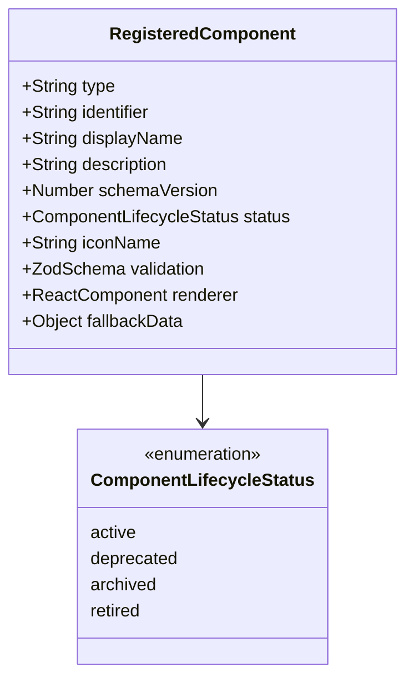
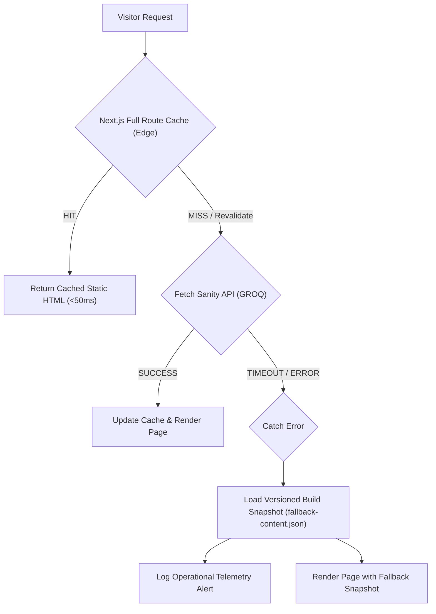

# Bhavatarini Catering Service — Sanity CMS Architecture & Component Registry

**Document Reference:** `docs/SANITY_CMS_ARCHITECTURE.md`  
**Revision:** 2.1 (Final Architecture Review Corrections)  
**Date:** November 2026  
**Status:** Architecture Blueprint & Evaluation (Stage A — Documentation Only)  
**Target Codebase:** Next.js App Router (`src/`, `sanity/`)  
**Design Reference:** `docs/reference/bhavatarini_catering_royal_green_premium_v2.html`

---

## Executive Summary

This document defines the architecture for integrating **Sanity CMS** with **Next.js App Router** for Bhavatarini Catering Service, alongside **Supabase** for operational customer enquiry management.

This revision (v2.1) incorporates the final pre-implementation corrections:
1. **Menu Content Status:** All dish names retained from the reference prototype are strictly designated as **unverified draft examples** rather than confirmed offerings. Menus in Sanity will hold a `draft_unverified` status until confirmed by the business owner.
2. **Neutral Service Descriptions:** Removal of unsupported quality claims and operational promises (such as "reliable", guaranteed delivery, specific meal schedules, or unverified customization promises). Factual, neutral phrasing is used for the five confirmed service categories.
3. **Rigorous Image Approval Gate:** Generic stock platform links are recognized as insufficient. Candidate images will require exact photo-page URLs, direct image previews, individual commercial license verification, and verified dimensions. Image replacement remains **strictly blocked** pending owner sign-off, and official logo integration remains **pending receipt of the actual logo file**.
4. **Valid Schema.org & Factual SEO:** Elimination of unconfirmed production domain URLs (`https://bhavatarinicatering.com`) and unconfirmed service area declarations. Only confirmed facts (business name, Coimbatore location, South Indian cuisine, 5 service categories) are included in standard Schema.org markup. The SEO title is documented as a working recommendation.
5. **Sanity Free Tier Realities:** Explicit documentation of Administrator/Viewer role boundaries, public dataset boundaries, hard caps, and usage monitoring without perpetual free guarantees.
6. **Resilient Fallback & Component Lifecycle:** Explicit archive storage, versioned build-time snapshot (`fallback-content.json`), Next.js multi-tier edge caching, and automated recoverability test requirements.

---

## 1. Sanity CMS vs. Supabase Responsibilities & Architecture

Responsibilities are strictly divided between editorial marketing content and operational customer data:

```mermaid
flowchart TD
    subgraph Editorial Layer [Sanity CMS - Content & Media]
        S1["Marketing Copy & Section Headings"]
        S2["Confirmed Service Offerings (5 Categories)"]
        S3["South Indian Meals & Tiffin Content (Draft Status)"]
        S4["Hero, Why Us, Experience Copy"]
        S5["Culinary Photographs & WebP Transformation"]
        S6["Page Section Order & Visibility Toggles"]
        S7["SEO Metadata (Recommended Title & Description)"]
    end

    subgraph FrontEnd [Next.js App Router - Edge Presentation & ISR]
        R1["Server Components (RSC)"]
        R2["Central Component Registry"]
        R3["Dynamic Section Dispatcher"]
        R4["Next.js Multi-Tier Cache (Stale-While-Revalidate)"]
        R5["Visual Editing (Draft Mode)"]
        R6["Versioned Fallback Content Snapshot"]
    end

    subgraph Operational Layer [Supabase - Enquiries & Security]
        D1["Customer Enquiries (Form Leads)"]
        D2["Operational Admin Authentication (RBAC)"]
        D3["Enquiry Workflow (New, In Review, Completed)"]
        D4["Internal Admin Notes & Audit Trail"]
        D5["Row Level Security (RLS) Policies"]
    end

    Editorial Layer -->|GROQ Queries / CDN| FrontEnd
    FrontEnd -->|Server Action / Route Handler| Operational Layer
```

### Responsibility Matrix

| Domain | Platform | Rationale | Cost & License Profile |
| :--- | :--- | :--- | :--- |
| **Editorial Content** | **Sanity CMS** | Schema-as-code, real-time visual editing, version history, visual image cropping/hotspots. | **Free Tier** with hard caps; upgradeable to Growth ($15/seat/month) if role granularity or private datasets become necessary. |
| **Media & Images** | **Sanity Asset Pipeline** | Responsive WebP/AVIF generation, blurhash placeholders, focal-point cropping. | Included in Sanity asset storage (100 GB) and CDN bandwidth quotas (100 GB/mo). |
| **Page Composition** | **Sanity (Page Builder)** | Content managers can reorder, hide/show, and add registered sections without code edits. | Native Sanity array functionality. |
| **Customer Enquiries** | **Supabase PostgreSQL** | Relational integrity, strict transaction guarantees, and customer PII isolation. | **Free Tier** (500 MB database, 50,000 monthly active users). |
| **Enquiry Access Security** | **Supabase Auth** | Protects internal booking dashboards and customer data behind Row Level Security (RLS). | Built-in Supabase security layer. |
| **Editorial Access** | **Sanity Studio Auth** | Native Google, GitHub, or Email SSO for editors. | Up to 20 user seats on Free tier (limited to Administrator and Viewer roles). |

---

## 2. Sanity Free Tier Quotas, Roles & Limitations

Sanity's published pricing and documentation establish the following boundaries for the Free plan:

### 2.1 Quotas & Resource Boundaries

| Resource Dimension | Free Tier Allowance | What Happens When Limit Is Reached? |
| :--- | :--- | :--- |
| **User Seats** | **Up to 20 seats** | Additional users cannot be invited unless existing seats are freed or the project upgrades to Growth ($15/seat/month). |
| **Available Roles** | **Administrator & Viewer ONLY** | Custom or granular roles (such as *Editor*, *Contributor*, or *Developer*) are **not available** on Free. Content editors must be granted `Administrator` (full read/write/delete/deploy access) or `Viewer` (read-only). |
| **Datasets** | **2 Datasets (Strictly Public)** | Private datasets are **not supported** on Free. Creating a private dataset requires the Growth tier. |
| **Documents** | **10,000 documents** | Document creation is blocked once 10,000 documents are reached across datasets (excluding asset documents). |
| **Asset Storage** | **100 GB** | Asset uploads fail once the 100 GB threshold is reached. |
| **API Requests** | **250,000 requests / month** | Hard cap. Uncached API calls are rejected with `429 Too Many Requests` when exhausted. |
| **API CDN Requests** | **1,000,000 requests / month** | Hard cap. Cached queries are throttled or blocked when exceeded. |
| **Bandwidth** | **100 GB / month** | Asset downloads and API payloads are blocked/metered when exhausted. |

### 2.2 Operational Guidelines
1. **Public Dataset Boundary:** Datasets on the Free plan are strictly public. **Zero customer enquiries, form submissions, or confidential records may ever be stored in Sanity.** All customer interactions route exclusively to Supabase with Row Level Security (RLS).
2. **Administrator Role for Editors:** Staff members invited to edit content will hold `Administrator` status. Operational protocols will be established to avoid inadvertent schema or webhook changes.
3. **Usage Monitoring:** We recommend starting on the Free tier and monitoring resource metrics. **We do not claim that the website is guaranteed to operate free indefinitely.**

---

## 3. Dynamic Component Registry Architecture

The website will implement a **Central Component Registry** (`src/components/registry/`). Only intentionally registered components can be rendered.



### 3.1 Component Registry Catalog

| Component Type (`_type`) | Stable ID | Display Name | Schema Version | Status | React Renderer |
| :--- | :--- | :--- | :---: | :---: | :--- |
| `section.hero` | `hero` | Hero Banner & Intro | 1.0 | `active` | `HeroSection` |
| `section.trustStrip` | `trust-strip` | Trust & Assurance Strip | 1.0 | `active` | `TrustStrip` |
| `section.services` | `services` | Catering Services Grid | 1.0 | `active` | `ServicesSection` |
| `section.experience` | `experience` | The Bhavatarini Experience | 1.0 | `active` | `ExperienceSection` |
| `section.menu` | `menu` | South Indian Meals & Tiffin | 1.0 | `active` | `MenuSection` |
| `section.whyUs` | `why-us` | Why Choose Us (Pillars) | 1.0 | `active` | `WhyUsSection` |
| `section.ctaBanner` | `cta-banner` | Pre-Contact Call to Action | 1.0 | `active` | `CtaBanner` |
| `section.contact` | `contact` | Contact & Enquiry Form | 1.0 | `active` | `ContactSection` |

---

## 4. Component Lifecycle & Data Preservation Architecture

When a website section is updated, replaced, or phased out, its underlying content must survive:

```mermaid
stateDiagram-v2
    [*] --> Active: Developer builds component & registers schema
    Active --> Deprecated: Component superseded; editorial warning rendered
    Deprecated --> Active: Rollback / Reinstatement
    Deprecated --> Archived: Removed from active page array; moved to Archive Store
    Archived --> Retired: React renderer safely removed from frontend build
    Retired --> [*]: Permanent deletion (requires manual database approval)
```



### 4.1 Lifecycle States & Enforcement
1. **`active`:** Visible and insertable in Sanity Studio; fully supported by frontend renderers.
2. **`deprecated`:** Existing instances continue rendering; Sanity Studio displays a warning notice; new instances cannot be added.
3. **`archived`:** Removed from the active `sections` array and stored in an explicit **Archive Document** (`archivedSections` collection in Sanity), preserving content outside transient document history.
4. **`retired`:** React renderer is removed from frontend code. Historical content remains safely preserved in Sanity.

### 4.2 Handling of Unknown or Retired Components
- **Production Mode:** Silently returns `null` and logs a structured warning (`console.warn('[CMS_DISPATCHER] Unknown or retired component skipped:', section._type)`). Surrounding page sections render normally.
- **Preview Mode:** Displays a diagnostic banner indicating the unrendered type.

### 4.3 Versioned Schema Migrations & Recoverability Testing
- Breaking schema changes increment `schemaVersion`.
- CLI migration scripts (`sanity/migrations/v<N>-<name>.ts`) transform historical dataset records.
- Automated tests (Vitest/Jest) verify deserialization of archived JSON payloads, schema transformation accuracy, and unknown component safety.

---

## 5. Resilient Fallback & Edge Caching Architecture

To prevent website failures when Sanity is temporarily unreachable:



### 5.1 Architecture Rules
1. **Single Editorial Source of Truth:** Sanity CMS is the sole editable content source.
2. **Versioned Build Snapshot (`fallback-content.json`):** Next.js bundles an immutable, validated static snapshot generated during build.
3. **Edge Caching Protection (Stale-While-Revalidate):** The public site is served from pre-rendered edge HTML via Incremental Static Regeneration (ISR).
4. **Fault Tolerance Boundary:** If a revalidation request encounters a network error, the fetch handler catches the failure, falls back to the bundled snapshot, and logs telemetry. **We do not make blanket "zero downtime" guarantees.**

---

## 6. Verified Business Content & Editorial Guidelines

All copy strictly adheres to verified business facts without promotional embellishments or unverified commitments:

### 6.1 Confirmed Business Baseline
- **Business Name:** Bhavatarini Catering Service
- **Confirmed Location:** Coimbatore, Tamil Nadu
- **Confirmed Cuisine:** South Indian meals and tiffin
- **Five Confirmed Service Categories:**
  1. Corporate Catering
  2. Small Family Functions
  3. Group Gatherings
  4. Daily Meal Supply
  5. Startup and Office Catering

### 6.2 Menu Content: Draft / Unverified Status
- **Explicit Rule:** All dish names retained from the reference prototype (*Rice, Sambar, Rasam, Kuzhambu, Poriyal, Appalam, Curd, Payasam, Pickle*; *Idli, Dosa, Pongal, Upma, Vada, Bajji, Samosa*) are strictly **unverified draft examples**.
- **Sanity Schema Status:** The menu schema will include an `editorialStatus` field set to `'draft_unverified'`. They will **not** be presented as confirmed business offerings until verified by the owner.

### 6.3 Approved Neutral Service Copy (Free of Unverified Claims)
- ❌ Removed all unsupported terms: *"reliable"*, *"guaranteed delivery"*, *"specific meal schedules"*, *"customised dietary plans"*, *"executive meal arrangements"*, *"freshly sourced ingredients"*, *"food safety certifications"*.

#### A. Hero Section
- **Kicker:** `TRADITIONAL SOUTH INDIAN CATERING · COIMBATORE`
- **H1:**
  ```html
  Good Food.
  <br />
  <em class="text-[#e2cb8e] font-medium not-italic">Beautifully</em> Served.
  <br />
  Every Occasion.
  ```
- **Description:**  
  *"Traditional South Indian catering services based in Coimbatore, Tamil Nadu. Providing South Indian meals and tiffin for corporate offices, family functions, gatherings, and daily meal supply."*

#### B. Services Section (Five Confirmed Categories — Neutral Phrasing)
1. **Corporate Catering:** *"Catering services for corporate offices and business events in Coimbatore."*
2. **Daily Meal Supply:** *"Daily South Indian meal supply for workplaces and teams in Coimbatore."*
3. **Startup & Office Catering:** *"Catering services for startups and office teams in Coimbatore."*
4. **Small Family Functions:** *"South Indian catering for family functions and gatherings."*
5. **Group Gatherings:** *"Catering arrangements for community gatherings and social events."*

#### C. Menu Section (Draft Framework)
- **Heading:** *"Our Menu"*
- **Full Meals (Draft Example):**  
  *"Traditional South Indian full meals prepared for gatherings and events. (Menu selections are draft examples pending final business confirmation)."*
- **Tiffin (Draft Example):**  
  *"South Indian tiffin selections organized for team and function requirements. (Menu selections are draft examples pending final business confirmation)."*

#### D. Experience Section
- **H2:**
  ```html
  Rooted in tradition.
  <br />
  <em class="text-[#e7cb82] font-medium not-italic">Served with care.</em>
  ```
- **Description:**  
  *"Assisting with food arrangements and catering service for gatherings in Coimbatore."*

#### E. Why Choose Us (Neutral Pillars)
1. **Traditional Recipes:** *"South Indian culinary preparations based on traditional recipes."*
2. **Service Coordination:** *"Catering arrangements organized around event requirements."*
3. **Kitchen Care:** *"Attentive preparation standards for all food orders."*
4. **Customer Support:** *"Direct communication and coordination from inquiry through event completion."*

#### F. Footer Tagline
> *"South Indian Catering in Coimbatore · Traditional Meals & Tiffin for Every Occasion"*

---

## 7. Image Replacement Gate & Formal Criteria (BLOCKED PENDING OWNER APPROVAL)

> [!IMPORTANT]
> **Image Replacement Status: STRICTLY BLOCKED**  
> Generic platform homepage links (such as unsplash.com or pexels.com) are **not sufficient** for image approval. No images will be downloaded, replaced, or modified until the exact criteria below are fulfilled and formally approved by the owner.

### 7.1 Mandatory Criteria for Candidate Image Approval
Before any image replacement can be submitted for owner sign-off, the action plan requires:
1. **Exact Candidate Image-Page URL:** Direct link to the individual photo page (e.g. `https://unsplash.com/photos/[id]`), not a generic search or category link.
2. **Direct Image Preview:** Visual thumbnail or direct preview rendering.
3. **Individual License Verification:** Explicit license terms confirming suitability for commercial web use without breach of copyright or model rights.
4. **Verified Image Dimensions & Aspect Ratio:** Native pixel dimensions, target aspect ratio (16:9, 4:5, 4:3), and WebP conversion budget ($\le 95\text{ KB}$ for cards, $\le 140\text{ KB}$ for banner).

### 7.2 Official Business Logo Gate
- The business has an existing official logo.
- We do **not** generate an arbitrary replacement.
- Integration remains **pending receipt of the actual logo vector or high-resolution file** from the owner.

---

## 8. Schema.org Structured Data Specification

> [!NOTE]
> `CateringService` is **not** a valid Schema.org type and has been eliminated. The structured data uses standard `["LocalBusiness", "FoodEstablishment"]` and `Service` offers.
> Unconfirmed production domains (`https://bhavatarinicatering.com`) and unconfirmed service area coverage have been removed.

### Valid JSON-LD Implementation (Strictly Verified Facts Only)

```html
<script type="application/ld+json">
{
  "@context": "https://schema.org",
  "@type": ["LocalBusiness", "FoodEstablishment"],
  "name": "Bhavatarini Catering Service",
  "description": "Traditional South Indian catering services based in Coimbatore, Tamil Nadu. Providing South Indian meals and tiffin for corporate offices, family functions, gatherings, and daily meals.",
  "servesCuisine": "South Indian",
  "address": {
    "@type": "PostalAddress",
    "addressLocality": "Coimbatore",
    "addressRegion": "Tamil Nadu",
    "addressCountry": "IN"
  },
  "hasOfferCatalog": {
    "@type": "OfferCatalog",
    "name": "Catering Services",
    "itemListElement": [
      {
        "@type": "Offer",
        "itemOffered": {
          "@type": "Service",
          "name": "Corporate Catering",
          "serviceType": "Catering"
        }
      },
      {
        "@type": "Offer",
        "itemOffered": {
          "@type": "Service",
          "name": "Daily Meal Supply",
          "serviceType": "Catering"
        }
      },
      {
        "@type": "Offer",
        "itemOffered": {
          "@type": "Service",
          "name": "Startup & Office Catering",
          "serviceType": "Catering"
        }
      },
      {
        "@type": "Offer",
        "itemOffered": {
          "@type": "Service",
          "name": "Small Family Functions",
          "serviceType": "Catering"
        }
      },
      {
        "@type": "Offer",
        "itemOffered": {
          "@type": "Service",
          "name": "Group Gatherings",
          "serviceType": "Catering"
        }
      }
    ]
  }
}
</script>
```

*Excluded Unconfirmed Attributes:*  
- No hardcoded website URL until the production domain is confirmed.
- No `areaServed` declaration until service radius/coverage is verified by the business.
- No telephone, street address, postal code, opening hours, coordinates, price range, or customer ratings.

---

## 9. Natural SEO Copy & Meta Recommendations

- **Recommended Page Title:**  
  `Bhavatarini Catering Service | South Indian Catering in Coimbatore`  
  *(Documented strictly as a recommendation; not claimed as finalized or deployed).*
- **Recommended Meta Description:**  
  `"Traditional South Indian catering services based in Coimbatore, Tamil Nadu. Providing meals and tiffin for corporate offices, family functions, gatherings, and daily meal supply."`
- **Zero Ranking Guarantees:** Search rankings and rich snippets are determined independently by search engine algorithms; no claims of ranking positions or rich results are made.

---

## 10. Implementation Safeguards

This task remains strictly **documentation only**. No source code in `src/` or configuration files have been modified. Stage B implementation has not started.
